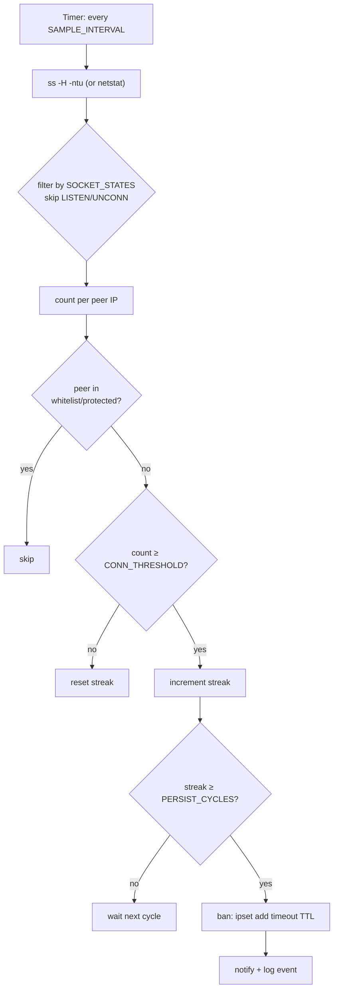
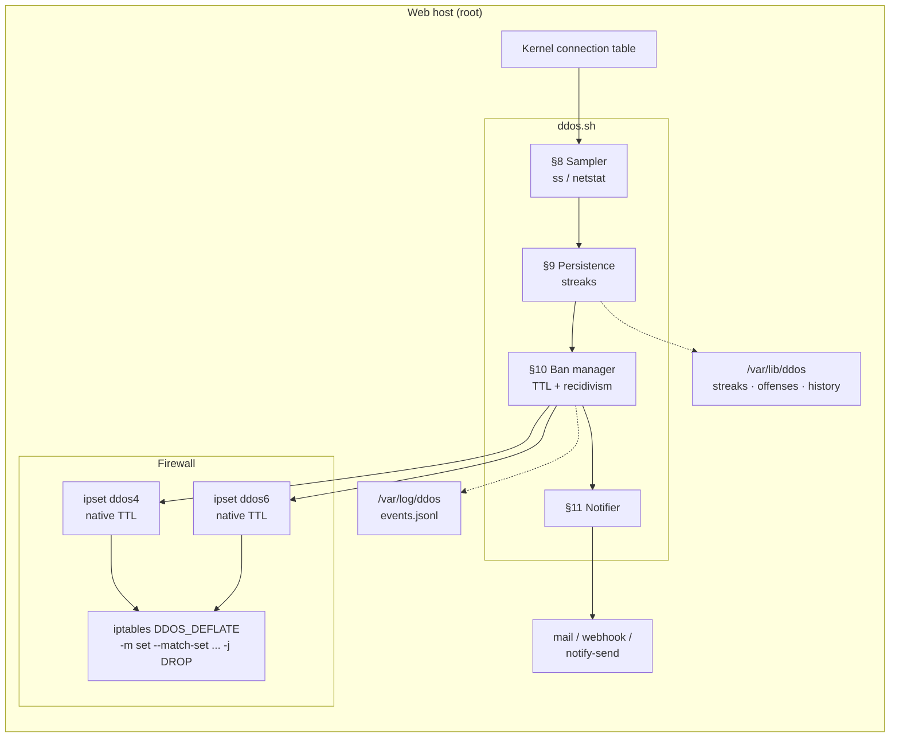

# SLICEisDeflate

**Connection-count based IP blocker for Linux servers.**

Watches the kernel's connection table, detects peers exceeding a connection
threshold across multiple consecutive sample cycles, and drops them via
`ipset` + `iptables` for a configurable TTL. Modern successor to the classic
[DDOS-Deflate 0.6](https://en.wikipedia.org/wiki/DDoS_Deflate) (Zaf, ~2012).

**Maintained by [`SL_CE'I_`](https://github.com/)**

> *SL_CE'I_ → SLICE'IS → "Slice is" → **Internet Security**, by design.*
> The two letters hidden behind the underscores spell **IS**.

[](#changelog)
[](#license)
[](#requirements)
[](#)

> ### ⚠️ Defensive tooling only
>
> This tool reads the local kernel's connection table and modifies the host's
> own `ipset` + `iptables`. It does not probe, scan, or send traffic to any
> remote host. There is no attack-generation capability here.

> ### ⚠️ The original 0.6 installer is unsafe
>
> The original `install.sh` downloads `ddos.sh`, `ddos.conf`,
> `ignore.ip.list`, and `LICENSE` over **plaintext HTTP** from
> `inetbase.com`, a domain that has been **dead for years**. Running that
> script today either fails or — if the domain is ever resurrected by a third
> party — installs arbitrary root-owned code. **Do not run the old installer.**
> This rewrite ships everything inside `ddos.sh`; `ddos.sh install` writes the
> config and lists locally with no network access.

---

## Table of contents

- [What it does](#what-it-does)
- [Why the name](#why-the-name)
- [Why a rewrite](#why-a-rewrite)
- [How it detects](#how-it-detects)
- [Architecture](#architecture)
- [Features](#features)
- [Files](#files)
- [Requirements](#requirements)
- [Install](#install)
- [First run (dry-run)](#first-run-dry-run)
- [Usage](#usage)
- [Configuration reference](#configuration-reference)
- [Sampler details](#sampler-details)
- [Operations & monitoring](#operations--monitoring)
- [Rollback](#rollback)
- [Background: DDoS, attack types, defenses](#background-ddos-attack-types-defenses)
- [Safety warnings](#safety-warnings)
- [Changelog](#changelog)
- [Credits](#credits)
- [License](#license)

---

## What it does

1. Every `SAMPLE_INTERVAL` seconds (default 60), snapshot the kernel's active
   connections via `ss` (or `netstat` on legacy systems).
2. Count connections per peer IP, filtered by state (default
   `ESTAB,SYN_RECV`).
3. Any peer whose count stays at or above `CONN_THRESHOLD` for
   `PERSIST_CYCLES` consecutive cycles is banned.
4. Bans go into an `ipset` with a TTL, matched by a single `iptables` rule in
   the `DDOS_DEFLATE` chain. **O(1) match, auto-expiry, one rule total.**
5. Bans escalate on repeat offenses (`DEFAULT_TTL × TTL_STEP^(n-1)`, capped
   at `MAX_TTL`).
6. Optional: port-scan detection (`SCAN_THRESHOLD`) bans peers hitting many
   distinct local ports.
7. Every decision is written to `/var/log/ddos/events.jsonl` and, optionally,
   emailed/webhooked.

---

## Why the name

**SLICEisDeflate** is a phonetic expansion of the author's tag `SL_CE'I_`:

| Form | Reading |
|---|---|
| `SL_CE'I_` | The tag — two underscores hide two letters |
| `SLICE'IS` | Expanded — the hidden letters are **I** and **S** |
| "Slice is" | Phonetic — reads as the English words |
| **I**nternet **S**ecurity | What the hidden IS stands for |
| SLICEisDeflate | The product — "Slice is Deflate" |

The GitHub slug is `SLICEisDeflate` (no apostrophe, no quotes) because GitHub
only accepts alphanumerics, hyphens, underscores, and periods in repo URLs.
Everywhere a human reads the name — title, badges, footer, docs — the full
tag `SL_CE'I_` is preserved.

The script (`ddos.sh`), its CLI command (`ddos`), install paths, and
configuration file names are **unchanged** from the DDoS-Deflate lineage.
Only the project name and author attribution have been updated to fit the
SL_CE'I_ suite naming convention.

---

## Why a rewrite

The 0.6 installer is not salvageable:

| Problem in 0.6 | Why it matters |
|---|---|
| Downloads over `http://www.inetbase.com/...` | Domain dead; if revived, any served bytes run as root |
| No integrity check (no SHA256, no signature) | Same |
| `netstat` required | Removed from default installs on RHEL 9+, Debian 12+, Ubuntu 22.04+ |
| IPv4 only | IPv6 attacks invisible |
| `iptables -A` only | New rules go after existing `ACCEPT` — bans may not apply |
| `awk '{print $5}'` → `iptables` | No IP validation; injection surface |
| `ignore.ip.list` compared as string | CIDRs never matched |
| `ddos.conf` is `source`d | Shell injection if the file is ever writable by a lower-privilege user |
| No dry-run | Cannot tune without risking lockout |

This rewrite fixes all of the above and adds the safety features of modern
defensive tooling: `ipset`, JSON logging, digest alerts, graceful shutdown,
`flock` single-instance, sandboxed systemd unit.

---

## How it detects



A peer with 500 connections in a single cycle but 0 in the next is *not*
banned. The persistence requirement (`PERSIST_CYCLES`) is what keeps this
tool from banning browsers with many tabs open or legitimate connection
pooling.

---

## Architecture



---

## Features

| Feature | Notes |
|---|---|
| `ss` primary, `netstat` fallback | Works on any modern distro |
| IPv4 + IPv6 | `ipset inet` + `ipset inet6` |
| `ipset` + single `iptables` rule | O(1) match, native TTL, no chain bloat |
| Dedicated `DDOS_DEFLATE` chain | Isolated, easy to inspect and tear down |
| Persistence gate | `PERSIST_CYCLES` consecutive cycles above threshold |
| Recidivism | `DEFAULT_TTL × TTL_STEP^(n-1)`, capped |
| CIDR-aware whitelist | `ipset hash:net`, checked before scoring |
| Protected ranges | RFC1918, loopback, link-local always safe |
| Optional port-scan detection | `SCAN_THRESHOLD` on distinct local ports |
| Dry-run | `--dry-run` logs `would_ban`, changes nothing |
| Structured event log | JSON Lines at `$LOGS_DIR/events.jsonl` |
| Digest notifier | mail + webhook + notify-send, batched |
| `flock` single instance | Second invocation exits cleanly |
| Graceful signals | TERM/INT stop, HUP reload, USR1 stats |
| One-command rollback | `ddos.sh teardown` |
| Sandboxed systemd unit | `Protect*`, `Restrict*`, `PrivateTmp` |
| Self-contained install | `ddos.sh install` writes config/lists/unit locally |
| Config allowlist | Only whitelisted keys honored |
| `set -euo pipefail` | No `eval`, no unquoted expansions |

---

## Files

Delivered as **two files**:

| File | Purpose |
|---|---|
| `ddos.sh` | The entire tool. All config defaults embedded; `install` writes them to disk. |
| `README.md` | This document. |

Files created by `ddos.sh install`:

```text
/usr/local/ddos/ddos.sh                    (the script itself)
/usr/local/sbin/ddos                       (symlink)
/etc/ddos/ddos.conf                        (config; editable)
/etc/ddos/ignore.ip.list                   (whitelist; never-ban)
/etc/ddos/block.ip.list                    (manual bans)
/etc/systemd/system/ddos.service           (only if systemd present)
/var/lib/ddos/                             (streaks, offenses, ban history)
/var/log/ddos/events.jsonl                 (structured event log)
```

---

## Requirements

| Component | Minimum | Notes |
|---|---|---|
| Linux kernel | 3.x+ | `ipset` support required |
| `bash` | 4.3+ | `printf -v`, associative arrays, `read -ra` |
| `ipset` | any | `apt install ipset` / `dnf install ipset` |
| `iptables` | any (incl. `iptables-nft`) | nft-backed on RHEL 9+ / Debian 12+ |
| `ss` | any | Ships with `iproute2` (default everywhere modern) |
| `netstat` | optional fallback | `net-tools` package; not required |
| `flock` | util-linux | Standard |
| `ip6tables` | optional | For IPv6 bans |
| `curl` | optional | Webhook notifications |
| `mail` / `sendmail` | optional | Email notifications |
| `notify-send` | optional | Desktop notifications |
| `systemctl` | optional | `install` uses it if present; otherwise cron |

Root (or `CAP_NET_ADMIN`) is required for `ipset` and `iptables` operations.

---

## Install

### systemd (recommended)

```bash
# From a clone of this repo:
sudo ./ddos.sh install
```

The installer:

1. Copies `ddos.sh` to `/usr/local/ddos/`
2. Symlinks `/usr/local/sbin/ddos → /usr/local/ddos/ddos.sh`
3. Writes `/etc/ddos/ddos.conf` with embedded defaults (preserves existing)
4. Writes `/etc/ddos/ignore.ip.list` and creates `/etc/ddos/block.ip.list`
5. Writes `/etc/systemd/system/ddos.service` with sandboxing
6. `systemctl daemon-reload && systemctl enable --now ddos.service`

**Before** enabling enforcement, edit the config and run a dry-run:

```bash
sudo vi /etc/ddos/ddos.conf
sudo ddos --dry-run run
```

### SysV / cron

If `systemctl` is not available, `install` prints a cron line you can add:

```cron
* * * * * root /usr/local/ddos/ddos.sh --config /etc/ddos/ddos.conf once
```

The `once` subcommand runs one full sample cycle and exits, so it is safe to
schedule from cron.

---

## First run (dry-run)

```bash
# 1. Install (creates config, lists, unit).
sudo ./ddos.sh install

# 2. Edit /etc/ddos/ddos.conf. At minimum:
#    - CONN_THRESHOLD (default 100)
#    - NEVER_BAN / ignore.ip.list
#    - MAIL_TO

# 3. Verify the sampler works against your kernel:
sudo ddos check
sudo ddos test

# 4. Dry-run in the foreground for 24h. Nothing touches the firewall.
sudo ddos --dry-run run

# 5. Watch what it would have done:
tail -f /var/log/ddos/events.jsonl | jq -c 'select(.event=="would_ban")'
```

When the dry-run log looks right, enable enforcement:

```bash
sudo systemctl restart ddos
```

---

## Usage

```text
ddos [options] [command]

Commands:
  run           Start the daemon (default)
  once          Run one sample cycle and exit
  status        Daemon state, ban counts, sampler
  list          List currently banned IPs
  unban <ip>    Remove from ban set and clear offense counter
  test          Show current connections and per-peer counts
  check         Validate config, sampler, and privileges
  install       Install script, config, lists, and systemd unit
  uninstall     Disable unit, remove files, tear down firewall
  teardown      Remove firewall objects only (keep service files)

Options:
  -c, --config <file>   Config file (default: /etc/ddos/ddos.conf)
      --dry-run         Do not modify firewall; log intended actions
  -v, --verbose         Per-cycle tracking output
  -h, --help            Help
      --version         Print version
```

### Common operations

```bash
# Status snapshot
sudo ddos status

# Currently banned IPs
sudo ddos list

# Unban one IP (clears offense counter)
sudo ddos unban 203.0.113.5

# Reload config and lists without dropping bans
sudo systemctl reload ddos          # sends SIGHUP

# Dump stats to syslog
sudo kill -USR1 $(cat /var/lib/ddos/ddos.pid)

# Watch decisions live
tail -f /var/log/ddos/events.jsonl | jq .

# Re-load lists and config on a cron-only system
sudo ddos --config /etc/ddos/ddos.conf once
```

### Signals

| Signal | Effect |
|---|---|
| `SIGTERM` / `SIGINT` | Graceful shutdown — flush digest, exit |
| `SIGHUP` | Reload `ddos.conf` and both list files |
| `SIGUSR1` | Dump `banned4`, `banned6`, `tracked` counters to syslog |

---

## Configuration reference

All keys live in `/etc/ddos/ddos.conf`. Unknown keys are ignored with a
warning (allowlist enforced in `ddos.sh` §1).

### Detection

| Key | Default | Notes |
|---|---|---|
| `SAMPLE_INTERVAL` | `60` | Seconds between samples |
| `CONN_THRESHOLD` | `100` | Conns per peer to trigger tracking |
| `PERSIST_CYCLES` | `3` | Consecutive cycles above threshold |
| `MIN_CONNECTIONS` | `10` | Peers below this are not counted |
| `SOCKET_STATES` | `ESTAB,SYN_RECV` | Comma-separated states to count |
| `SCAN_THRESHOLD` | `0` | Distinct local ports for port-scan ban (0 = off) |
| `DISTINCT_PORTS_THRESHOLD` | `20` | Internal tunable for port-scan logic |

### Ban lifecycle

| Key | Default | Notes |
|---|---|---|
| `DEFAULT_TTL` | `3600` | Base ban, seconds |
| `TTL_STEP` | `2` | Recidivism multiplier |
| `MAX_TTL` | `604800` | Hard cap (7 days) |

### Lists

| Key | Default | Notes |
|---|---|---|
| `NEVER_BAN` | `/etc/ddos/ignore.ip.list` | Never-ban list |
| `MANUAL_BAN` | `/etc/ddos/block.ip.list` | Manual ban list |
| `PROTECTED_RANGES` | RFC1918 + loopback + link-local | Always protected |

### Firewall

| Key | Default | Notes |
|---|---|---|
| `IPSET_NAME` | `ddos4` | Runtime IPv4 set |
| `IPSET_NAME6` | `ddos6` | Runtime IPv6 set |

### Notifications

| Key | Default | Notes |
|---|---|---|
| `NOTIFY` | `digest` | `none` / `digest` / `per-ip` |
| `DIGEST_MINUTES` | `15` | Digest cadence |
| `MAIL_TO` | `admin@localhost` | Email recipient |
| `WEBHOOK_URL` | _(empty)_ | Generic JSON webhook |

### Runtime

| Key | Default | Notes |
|---|---|---|
| `STATE_DIR` | `/var/lib/ddos` | Streaks, offenses, history |
| `LOGS_DIR` | `/var/log/ddos` | `events.jsonl` |

---

## Sampler details

`ddos.sh` uses `ss` when available, `netstat` otherwise:

```bash
ss -H -ntu                    # modern (iproute2)
netstat -ntu | tail -n +3     # fallback (net-tools)
```

Both are parsed by `awk` with per-tool field offsets:

| Tool | Local addr | Peer addr | State |
|---|---|---|---|
| `ss -H -ntu` | `$5` | `$6` | `$2` |
| `netstat -ntu` | `$4` | `$5` | `$6` |

Filtering rules (in `count_by_peer`):

- Skip rows whose state is not in `SOCKET_STATES`
- Skip peer fields ending in `*` (listening sockets)
- Strip the port from the peer address
- Strip `[` `]` (IPv6 bracketing)
- Skip `0.0.0.0` and `::`
- Require the remaining string to match IPv4 or IPv6 syntax

Only peers with `count >= MIN_CONNECTIONS` are returned. The rest are
discarded — that's what makes the tool cheap to run at scale.

### The one-liner from the original README

The old README showed this:

```bash
netstat -ntu | awk '{print $5}' | cut -d: -f1 | sort | uniq -c | sort -n
```

That still works manually, but `ss` is the modern equivalent:

```bash
ss -H -ntu | awk '{print $6}' | sed 's/:[0-9]*$//; s/[][]//g' | sort | uniq -c | sort -n
```

Both are useful for a quick eyeball; `ddos.sh test` shows you the same data
the daemon actually sees.

---

## Operations & monitoring

### Structured event log

`/var/log/ddos/events.jsonl`, one JSON object per line:

```json
{"ts":"2025-01-15T14:00:00Z","pid":2001,"event":"start","interval":"60","threshold":"100","cycles":"3","dry_run":"no"}
{"ts":"2025-01-15T14:01:00Z","pid":2001,"event":"ban","ip":"203.0.113.5","ttl":"3600","offense":"1","reason":"count=427,cycles=3"}
{"ts":"2025-01-15T14:16:00Z","pid":2001,"event":"notify_sent","count":"1"}
{"ts":"2025-01-15T15:00:00Z","pid":2001,"event":"stop"}
```

### Ban history

`/var/lib/ddos/ban-history`, one line per ban:

```text
2025-01-15T14:01:00Z 203.0.113.5 3600 1 count=427,cycles=3
2025-01-15T14:05:32Z 198.51.100.7 7200 2 count=891,cycles=3
```

Columns: timestamp, IP, TTL seconds, offense number, reason. Useful for
post-incident review.

### Useful jq one-liners

```bash
# All bans in the last hour
jq -c 'select(.event=="ban")' /var/log/ddos/events.jsonl \
  | jq -c 'select(.ts > (now - 3600 | todate))'

# Top banned IPs
jq -r 'select(.event=="ban") | .ip' /var/log/ddos/events.jsonl \
  | sort | uniq -c | sort -rn | head

# Reason distribution
jq -r 'select(.event=="ban") | .reason' /var/log/ddos/events.jsonl \
  | sed 's/count=.*/count/' | sort | uniq -c
```

### Log rotation

Add a stanza for the events file:

```conf
/var/log/ddos/events.jsonl {
    weekly
    rotate 8
    compress
    missingok
    notifempty
    copytruncate
}
```

The daemon itself does not need rotation — it only reads the kernel's
connection table, never a file.

---

## Rollback

```bash
# Remove firewall objects only (keep service and config):
sudo ddos teardown

# Full uninstall:
sudo ddos uninstall
```

`teardown` and `uninstall` both remove:

- the `DDOS_DEFLATE` iptables chain and its jump from `INPUT`
- the `DDOS_DEFLATE` ip6tables chain and its jump
- the `ddos4` and `ddos6` sets
- the `ddos4_never4/6`, `ddos4_manual4/6` sets

If a bad threshold has locked out legitimate traffic, `ddos teardown` is your
one-command recovery. The daemon continues running but no new traffic is
dropped until the chain is recreated.

---

## Background: DDoS, attack types, defenses

A distributed denial-of-service attack (DDoS) is a class of attack where an
online service is made unavailable to its intended users by overwhelming it
with traffic from many sources. It is one of the most common forms of network
abuse because the tools to carry it out are freely available and easy to use,
and because any exposed service — a website, an API, a game server, a mail
relay — can be targeted. Attackers typically send floods of UDP, TCP, or HTTP
requests, and the victim's ability to respond is exhausted long before the
attackers' resources are.

### Three categories of DDoS attack

**1. Application-layer attacks** target the application itself, at the top of
the OSI model. They are measured in requests per second (RPS), and they are
designed to look like legitimate traffic to a load balancer or WAF. Examples
include HTTP floods, Slowloris, and expensive-query attacks against search or
login endpoints. They are the hardest to filter because the individual
requests may be indistinguishable from real users.

**2. Protocol attacks** target server and network resources rather than raw
bandwidth. They consume connection state, session tables, or firewall
memory. Examples include SYN floods (which fill the half-open connection
table), fragmented packet attacks, and ping-of-death variants. Protocol
attacks can take a service offline while barely touching the bandwidth
graph.

**3. Volumetric attacks** saturate the victim's upstream bandwidth with raw
traffic, so nothing — legitimate or otherwise — reaches the server. They are
measured in bits per second, and they can be generated by reflection and
amplification techniques (DNS, NTP, memcached, SSDP), which let a small
attacker request produce a large response toward the victim. This is the
category that dominates the news because the numbers are dramatic, but it is
not the only category that matters.

Most real incidents are combinations: a volumetric flood to saturate the
link, paired with an application-layer flood to overwhelm the backend once
traffic does arrive.

### Three phases of DDoS defense

**1. Prevention and preemption — before the attack.** This is where most of
the defensive value lives, and it is entirely under your control. Harden
recursive resolvers so they cannot be used as amplifiers. Enable ingress
filtering (BCP 38) so spoofed source addresses cannot leave your network.
Configure rate limits on your own services. Keep the attack surface minimal:
no exposed debug endpoints, no unauthenticated status pages, no default
credentials. A well-run server is uninteresting to a volumetric attacker and
resilient to the application-layer ones.

**2. Detection and filtering — during the attack.** This is where tools like
SLICEisDeflate live. The goal is to notice that something is wrong — an
unusual connection count per peer, an unusual request rate, an unusual
response-size distribution — and to take *narrow* action before the whole
service is affected. Narrow is the key word: a good filter bans the specific
peer that is abusing you without banning an entire CIDR or a shared proxy,
and it un-bans automatically when the behavior stops.

**3. Attack source tracing — during and after the attack.** This is the
postmortem phase. Logs, flow records, and upstream coordination with your
provider let you identify where the traffic came from, whether it was
spoofed, and whether any of the source ranges are persistent repeat
offenders worth blocking permanently. It is also where you learn: which
threshold was too low, which legitimate traffic you accidentally caught,
which monitoring gap let the attack run longer than necessary.

### Where SLICEisDeflate fits

SLICEisDeflate belongs to phase 2 — detection and filtering. It watches the
kernel's connection table, notices when a single peer is holding an unusual
number of connections, and bans that peer's address for a configurable
window. It is a *narrow, reactive, low-footprint* control. It is **not** a
substitute for phase 1 hardening, and it cannot stop a volumetric attack
that exhausts your upstream bandwidth before your kernel ever sees the
packets.

What it can do, cheaply:

- Stop a slowloris-style HTTP flood where one IP holds hundreds of sockets.
- Stop a scripted brute-force against SSH or a login endpoint.
- Stop a scanner that opens many ports in quick succession (with
  `SCAN_THRESHOLD` enabled).
- Give you a few hours of breathing room while you investigate.

What it cannot do:

- Absorb a volumetric flood. That is a job for your upstream provider,
  a scrubbing service, or a CDN.
- Recognize an application-layer attack that looks like normal traffic. That
  is a job for rate limiting at the application layer, a WAF, or a
  behavioral analysis system.
- Replace firewall policy. It complements your existing rules; it does not
  define them.

### Keeping it simple

The original README had one line of advice that is still correct: *keep it
simple when setting up your first layer of defense.* The temptation with
tools like this is to add more filters, lower the thresholds, and ban more
aggressively. The result is almost always the same: you end up banning a
legitimate office, a shared VPN, or a CDN edge, and you spend more time
recovering from your own defense than you would have spent dealing with the
attack. Start conservative (high `CONN_THRESHOLD`, `PERSIST_CYCLES` of at
least 3), run in `--dry-run` for a full day, review the `would_ban` log, and
only then enable enforcement. Raise the thresholds if you see false
positives; lower them only when you have evidence that the current ones are
missing real attacks.

---

## Safety warnings

These are the guardrails that separate SLICEisDeflate from the original
DDoS-Deflate 0.6. Each one is either enforced in code or by config
validation.

### 1. Start in dry-run for at least 24 hours

`--dry-run` skips every `ipset add` call. Each intended ban is logged as
`would_ban` in `events.jsonl`. Review the log for false positives before
enabling enforcement.

### 2. `PERSIST_CYCLES` prevents single-cycle bans

The original banned on a single sample above the threshold. That is
catastrophically easy to trigger — a browser with many tabs, a legitimate
API client with a connection pool, a load balancer with keepalives. This
rewrite requires the peer to stay above the threshold for `PERSIST_CYCLES`
consecutive cycles before taking any action.

### 3. `MIN_CONNECTIONS` caps the work

Peers with fewer than `MIN_CONNECTIONS` active connections are not counted at
all. On a busy server, tracking every peer would be expensive; the ones below
the threshold are not interesting.

### 4. `MIN_CONNECTIONS` and `CONN_THRESHOLD` are cross-validated

The config check refuses to start if `MIN_CONNECTIONS > CONN_THRESHOLD`,
because that combination would make detection impossible while appearing
configured.

### 5. Whitelist is checked before scoring

Anything in `ignore.ip.list` or `PROTECTED_RANGES` (RFC1918, loopback,
link-local) is never tracked and never banned, regardless of how many
connections it holds. `PROTECTED_RANGES` is applied on every start, so a
truncated or empty whitelist cannot expose your LAN.

### 6. CIDRs are matched correctly

The original compared IPs as strings, so `/24` entries in `ignore.ip.list`
never matched. This rewrite loads the list into `ipset hash:net`, so CIDR
membership works.

### 7. `/0` and prefixes shorter than `/8` are refused

`FORCE_BROAD=yes` in the environment is required to load them. A single
mis-typed line like `0.0.0.0/0` in `ignore.ip.list` would otherwise disable
all enforcement; a similar typo in `block.ip.list` would block the whole
internet.

### 8. IPs are validated before they reach iptables

The original piped `awk '{print $5}'` straight into `iptables`, which is an
injection surface. This rewrite rejects any field that is not a valid IPv4
or IPv6 literal.

### 9. Bans go in a dedicated chain, inserted at the top of INPUT

The original used `iptables -A`, which appends after any existing `ACCEPT`
rules — the ban may not apply. This rewrite creates its own
`DDOS_DEFLATE` chain and inserts the jump at position 1 of `INPUT`, so the
ban is evaluated first.

### 10. Rollback is one command

`ddos.sh teardown` removes every ipset set and chain the tool created. It
leaves the config and the service files in place so you can re-enable.

### 11. Single-instance enforcement

`flock` on `$STATE_DIR/ddos.lock` prevents a second copy from racing on the
offense store or the notify queue.

### 12. Root is used minimally and visibly

The daemon runs as root because `ipset`/`iptables` require it. The systemd
unit narrows root with `ProtectSystem=full`, `ProtectHome=yes`,
`PrivateTmp=yes`, `RestrictAddressFamilies`, and `RestrictNamespaces`.
Review and tighten `ReadWritePaths` if your layout differs.

### 13. Structured events for post-incident review

`events.jsonl` records every decision with timestamp, IP, TTL, offense count,
and the reason that fired. This is what to hand to a SIEM or review after an
incident — not a rolling text log.

### 14. The old installer must not be run

If you find `install.sh` anywhere in an old checkout, do not run it. It
downloads from a dead domain over plaintext HTTP. Use `ddos.sh install`
instead.

---

## Changelog

### v2.0.0 — first release under the SLICEisDeflate name

> **Renaming note (README-only change):** The project was prepared internally
> as "DDoS-Deflate 2.0". It is now published as **SLICEisDeflate** to fit
> the SL_CE'I_ suite naming convention. The script (`ddos.sh`), its CLI
> command (`ddos`), install paths, and configuration file names are
> unchanged. Existing installs keep working; only the repo title and author
> attribution have been updated.

**Correctness and safety fixes over 0.6:**

| # | Bug (original) | Fix |
|---|---|---|
| 1 | `install.sh` fetched files over HTTP from a dead domain | All defaults embedded in `ddos.sh`; `install` writes them locally |
| 2 | Required `netstat` | `ss` primary, `netstat` fallback |
| 3 | IPv4 only | `ipset inet` + `ipset inet6` |
| 4 | `iptables -A` appended after ACCEPT | `DDOS_DEFLATE` chain inserted at `INPUT` position 1 |
| 5 | `awk '{print $5}'` fed into iptables unvalidated | Every IP checked against `is_ipv4`/`is_ipv6` |
| 6 | CIDRs in `ignore.ip.list` compared as strings | Loaded into `ipset hash:net` |
| 7 | `ddos.conf` was `source`d (shell injection) | Parsed with a strict allowlist; no `eval` |
| 8 | Single-cycle ban | `PERSIST_CYCLES` consecutive cycles required |
| 9 | No dry-run | `--dry-run` skips every firewall write |

**Adds:**

- `ipset` backend with native TTL, O(1) match, single iptables rule
- Recidivism escalation (`DEFAULT_TTL × TTL_STEP^(n-1)`, capped)
- Optional port-scan detection (`SCAN_THRESHOLD`)
- JSON event log + ban history file
- Digest notifier (mail + webhook + notify-send)
- Subcommands: `run`, `once`, `status`, `list`, `unban`, `test`, `check`,
  `install`, `uninstall`, `teardown`
- `flock` single-instance + PID file
- Signal traps (TERM/INT, HUP, USR1)
- Sandboxed systemd unit generated by `install`
- `set -euo pipefail`, `printf -v`, no `eval`, no unquoted expansions
- This README

**Files:**

| File | Change |
|---|---|
| `ddos.sh` | new — full rewrite as a single self-contained script |
| `README.md` | new — this file (originally prepared as DDoS-Deflate 2.0) |
| `install.sh` | **deleted** — replaced by `ddos.sh install` |

---

## Credits

Original DDOS-Deflate 0.6 by **Zaf** (`zaf@vsnl.com`), circa 2012. The
concept — watching the connection table and banning abusive peers — is
theirs. This rewrite keeps the idea and discards the delivery mechanism.

The measurement and detection model in this rewrite is informed by the same
principles used by modern connection-rate limiters and by the DDoS mitigation
literature (BCP 38 ingress filtering, `ipset`-based firewall design, and
response-rate limiting as described in the DNS and HTTP hardening literature).

---

## License

MIT — see `LICENSE`. Choose and commit a license file before publishing.

---

<p align="center">
  <strong>SLICEisDeflate</strong> — connection-aware, ipset-native, auditable.<br/>
  <sub>Maintained by <code>SL_CE'I_</code> · MIT License</sub>
</p>
